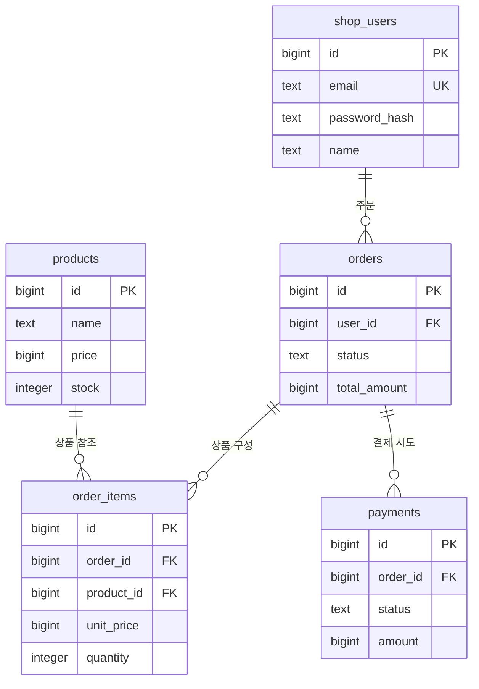

# 쇼핑몰 테이블 정의와 상품 구매 흐름

## 1. 문서 범위

STEP 1의 설계를 쉽게 이해하기 위한 문서입니다. 핵심 업무 테이블은 **회원·상품·주문·주문 상세·결제의 5개**이며, 인증을 위한 `sessions`를 포함하면 실제 테이블은 **6개**입니다.

ERD에는 핵심 관계와 주요 컬럼만 표시합니다. 아래 테이블 정의는 생성 SQL의 컬럼을 설명합니다. 기존에 사용하던 `public.users`와 구분하기 위해 쇼핑몰 회원 테이블 이름을 `public.shop_users`로 변경했습니다. 기존 테이블을 이름 변경하거나 데이터를 옮기는 작업이 아니라, 학습용 회원 테이블을 별도로 만드는 설계입니다. SQL이나 프로그램을 실행하지 않았으며 실제 DB는 변경하지 않았습니다.

장바구니는 별도 테이블 없이 `orders.status = 'cart'`로 표현합니다. 주문에는 상품이 여러 개 들어갈 수 있으므로 `order_items`를 분리합니다.

## 2. 간단한 ERD

별도 Mermaid 원본: [erd.mmd](erd.mmd)

아래 도표는 `erd.mmd`와 같은 내용입니다. Mermaid를 지원하는 Markdown 뷰어에서 렌더링할 수 있습니다. VSCode에서 도표가 코드로만 보이면 Mermaid 지원 Markdown 미리보기 확장이 필요합니다. `.mmd` 파일도 Mermaid 지원 뷰어로 열어 확인합니다.

### 관계 읽기

| 관계 | 의미 |
|---|---|
| 회원 → 주문 | 회원 한 명은 여러 주문을 가질 수 있습니다. |
| 주문 → 주문 상세 | 주문 하나에 여러 상품이 들어갑니다. 빈 장바구니는 상세가 0개입니다. |
| 상품 → 주문 상세 | 같은 상품이 여러 회원의 주문에 포함될 수 있습니다. |
| 주문 → 결제 | 결제 실패와 재시도를 기록하므로 결제가 여러 건일 수 있습니다. 성공은 최대 한 건입니다. |

`PK`는 행을 식별하는 기본키, `FK`는 다른 테이블을 참조하는 외래키, `UK`는 중복을 막는 고유키입니다. `||--o{`는 한 행에 연결된 행이 0개 이상인 관계입니다.

## 3. 테이블 정의

공통으로 `bigint` ID는 DB가 자동 생성합니다. 금액은 원화 정수이며, 시간은 시간대 정보를 포함하는 `timestamptz`입니다. 아래에서 선택값은 `NULL`을 허용합니다.

### 3.1 shop_users — 회원

| 컬럼 | 자료형 | 필수 여부 | 의미·규칙 |
|---|---|---|---|
| id | bigint | 필수 | PK, 회원 번호 |
| email | text | 활성 회원 필수 | UK, 앞뒤 공백 제거 및 소문자로 저장, 탈퇴 시 NULL |
| password_hash | text | 활성 회원 필수 | bcrypt 비밀번호 해시, 탈퇴 시 NULL |
| name | text | 활성 회원 필수 | 이름, 탈퇴 시 NULL |
| created_at | timestamptz | 필수 | 가입 시각, 기본값 현재 시각 |
| deleted_at | timestamptz | 선택 | 탈퇴 시각, 활성 회원은 NULL |

회원정보 수정은 `email`, `name`, `password_hash`를 변경합니다. 탈퇴 시 회원 번호와 구매 기록의 연결은 유지하고 개인정보를 제거합니다.

수정·탈퇴는 현재 비밀번호와 로그인 세션을 확인한 뒤 처리합니다. 이름만 수정하면 로그인을 유지하며, 이메일 또는 비밀번호를 바꾸면 모든 세션을 삭제해 다시 로그인하도록 합니다. 탈퇴 시 회원 개인정보 제거·주문 배송정보 제거·모든 세션 삭제를 한 트랜잭션으로 반영합니다.

### 3.2 products — 상품

| 컬럼 | 자료형 | 필수 여부 | 의미·규칙 |
|---|---|---|---|
| id | bigint | 필수 | PK, 상품 번호 |
| sku | text | 필수 | UK, 상품 코드 |
| name | text | 필수 | 상품명 |
| description | text | 필수 | 상품 설명, 기본값 빈 문자열 |
| price | bigint | 필수 | 현재 판매가, 0보다 큼 |
| stock | integer | 필수 | 재고, 0 이상, 기본값 0 |
| image_url | text | 선택 | 이미지 URL 또는 정적 파일 경로 |
| is_active | boolean | 필수 | 판매 여부, 기본값 true |
| created_at | timestamptz | 필수 | 등록 시각, 기본값 현재 시각 |

재고 0인 상품은 품절로 표시합니다. 주문 이력이 있는 상품은 삭제 대신 `is_active = false`로 판매를 중단합니다.

### 3.3 orders — 장바구니와 주문

| 컬럼 | 자료형 | 필수 여부 | 의미·규칙 |
|---|---|---|---|
| id | bigint | 필수 | PK, 주문 번호 |
| checkout_key | uuid | 선택 | UK, 주문 생성 요청 번호. 장바구니에서는 NULL, 주문 확정 시 저장 |
| user_id | bigint | 필수 | FK → shop_users.id |
| status | text | 필수 | cart / pending / paid, 기본값 cart |
| total_amount | bigint | 필수 | 확정 주문 금액, 장바구니에서는 0 |
| recipient_name | text | 선택 | 수령인 사본 |
| recipient_phone | text | 선택 | 수령인 연락처 사본 |
| shipping_address | text | 선택 | 배송주소 사본 |
| created_at | timestamptz | 필수 | 생성 시각, 기본값 현재 시각 |
| placed_at | timestamptz | 주문 확정 후 필수 | 주문 확정 시각 |
| paid_at | timestamptz | 결제 완료 후 필수 | 결제 완료 시각 |

| 상태 | 의미 | 금액과 시각 |
|---|---|---|
| cart | 장바구니 | total_amount = 0, placed_at·paid_at은 NULL |
| pending | 결제 대기 | total_amount > 0, placed_at 저장, paid_at은 NULL |
| paid | 결제 완료 | total_amount > 0, placed_at·paid_at 저장 |

회원당 `cart`는 최대 하나입니다. 장바구니 합계는 상세의 단가 × 수량으로 계산합니다. 주문 확정 시 서버에서 가격을 다시 확인하고 `total_amount`를 저장합니다.

STEP 5에서 중복 주문 생성을 막기 위해 `checkout_key`를 추가했습니다. 기존 DB에는 `sql/003_order_checkout_key.sql`을 실행해 반영합니다. 같은 요청 번호와 같은 내용의 재전송은 기존 주문 번호를 반환합니다. 결제 시도의 `payments.idempotency_key`와는 별개의 값입니다.

배송정보는 주문 확정 시 서버에서 필수로 검사합니다. DB에서는 탈퇴 시 익명화할 수 있도록 NULL을 허용합니다. 바로 구매는 기존 장바구니를 변경하지 않고 별도의 `pending` 주문을 생성합니다.

### 3.4 order_items — 주문 상세

| 컬럼 | 자료형 | 필수 여부 | 의미·규칙 |
|---|---|---|---|
| id | bigint | 필수 | PK, 상세 번호 |
| order_id | bigint | 필수 | FK → orders.id |
| product_id | bigint | 필수 | FK → products.id |
| product_name | text | 필수 | 상품명 사본 |
| unit_price | bigint | 필수 | 단가 사본, 0보다 큼 |
| quantity | integer | 필수 | 수량, 0보다 큼 |
| created_at | timestamptz | 필수 | 생성 시각, 기본값 현재 시각 |

`(order_id, product_id)` 조합은 중복할 수 없습니다. 같은 상품을 다시 담으면 수량을 늘립니다. 주문 확정 시 상품명·단가를 최신 값으로 저장하며, 이후에는 상품정보가 바뀌어도 구매 당시 정보를 유지합니다.

### 3.5 payments — 결제 시도

| 컬럼 | 자료형 | 필수 여부 | 의미·규칙 |
|---|---|---|---|
| id | bigint | 필수 | PK, 결제 번호 |
| order_id | bigint | 필수 | FK → orders.id |
| idempotency_key | uuid | 필수 | UK, 동일 요청의 중복 처리를 방지하는 키 |
| method | text | 필수 | mock, 기본값 mock |
| status | text | 필수 | succeeded / failed |
| amount | bigint | 필수 | 결제 시도 금액, 0보다 큼 |
| failure_reason | text | 실패 시 필수 | 실패 사유, 성공 시 NULL |
| created_at | timestamptz | 필수 | 결제 시도 시각, 기본값 현재 시각 |

동일 주문의 성공 결제는 최대 한 건입니다. 같은 요청을 재전송할 때는 같은 키를 사용하고, 실패 후 새로 결제할 때는 새 키를 사용합니다. 카드정보는 저장하지 않습니다.

STEP 6에서는 모의 결제 결과를 선택해 확인합니다. 성공 시 상품 재고 차감·성공 결제 기록·주문 paid 변경을 한 트랜잭션으로 커밋합니다. 모의 실패 또는 판매 중단·재고 부족 시 실패 결제만 저장하고 주문은 pending으로 유지합니다. 결제 금액은 주문 상세 사본의 합계와 확정 주문 금액이 일치하는지 검사한 뒤 사용합니다.

### 3.6 sessions — 인증 보조 테이블

핵심 구매 ERD에서는 생략했습니다. 관계는 `shop_users` 1 : N `sessions`입니다.

| 컬럼 | 자료형 | 필수 여부 | 의미·규칙 |
|---|---|---|---|
| id | bigint | 필수 | PK, 세션 번호 |
| user_id | bigint | 필수 | FK → shop_users.id |
| token_hash | text | 필수 | UK, 무작위 세션 토큰의 SHA-256 해시, 64자리 소문자 16진수 |
| created_at | timestamptz | 필수 | 생성 시각, 기본값 현재 시각 |
| expires_at | timestamptz | 필수 | 생성 시각보다 이후인 만료 시각 |

쿠키에는 원본 세션 토큰을, DB에는 해시만 저장합니다. 비밀번호 해시인 bcrypt와 세션 토큰 해시인 SHA-256은 용도가 다릅니다. 로그아웃은 해당 세션을 삭제하며, 탈퇴는 회원의 모든 세션을 삭제합니다.

## 4. 상품 구매 시뮬레이션 — 테이블 관점

> 아래 데이터와 번호는 이해를 돕기 위한 가상의 예시입니다. SQL이나 프로그램을 실행해서 얻은 결과가 아닙니다.

### 시작 조건

회원 1번인 김고객이 상품 10번인 머그컵을 2개 구매한다고 가정합니다. 머그컵 단가는 12,000원, 재고는 5개이며 배송비는 0원입니다.

| 테이블 | 시작 데이터 |
|---|---|
| shop_users | id=1, name=김고객 |
| products | id=10, name=머그컵, price=12000, stock=5 |
| orders / order_items / payments | 이번 구매 관련 데이터 없음 |

### ① 로그인

요청 → FastAPI가 `shop_users`의 비밀번호 해시 확인 → `sessions`에 세션 저장 → 브라우저에 HttpOnly 쿠키 응답.

`shop_users`, `products`의 데이터는 바뀌지 않습니다. 이후 인증이 필요한 요청은 쿠키와 세션을 확인합니다.

### ② 상품 조회

요청 → `products`에서 상품 조회 → 머그컵 가격과 재고를 화면에 표시.

조회만 하므로 테이블 데이터는 바뀌지 않습니다. 비로그인 사용자도 가능합니다.

### ③ 장바구니에 2개 담기

요청 → 로그인 확인 → 활성 장바구니가 없으면 `orders` 생성 → `order_items`에 상품 추가 → 장바구니 화면 응답.

| 테이블 | 설명용 데이터 |
|---|---|
| orders | id=100, user_id=1, status=cart, total_amount=0 |
| order_items | order_id=100, product_id=10, product_name=머그컵, unit_price=12000, quantity=2 |
| products | stock=5 유지 |
| payments | 아직 생성하지 않음 |

화면 합계는 `12000 × 2 = 24000원`입니다. 장바구니는 재고를 예약하지 않습니다.

비로그인 요청은 데이터 변경 전에 로그인 화면으로 이동하고, 로그인 후 이전 화면으로 복귀합니다. 사용자가 다시 담기 동작을 선택합니다.

### ④ 주문 확정

요청 → 소유자·상품 판매 여부·가격·수량·배송정보 확인 → 상세 사본과 주문 합계를 저장 → 결제 대기 화면 응답.

| 테이블 | 변화 |
|---|---|
| orders | id=100의 status를 pending으로 변경, total_amount=24000, 배송정보·placed_at 저장 |
| order_items | 확정 시점 상품명·단가를 저장하고 수량 2 확정 |
| products | stock=5 유지 |
| payments | 아직 생성하지 않음 |

장바구니에서 주문으로 전환할 때 주문 번호 100을 유지합니다. 이후 장바구니에 새 상품을 담으면 새로운 `cart` 주문을 생성합니다.

주문 확정 시 가격이 변경됐다면 변경 금액을 사용자에게 보여주고 재확인받는 흐름으로 구현합니다. 확정 이후에는 주문 상품·수량·금액을 수정하지 않습니다.

### ⑤ 모의 결제 성공

요청 → 주문 소유자·상태·중복 요청 확인 → 주문과 관련 상품 행을 잠금 → 재고 확인 → 아래 변경을 하나의 트랜잭션으로 저장 → 완료 화면 응답.

| 테이블 | 변화 |
|---|---|
| products | 상품 10의 stock을 5 → 3으로 차감 |
| payments | order_id=100, status=succeeded, amount=24000, 요청 키 K1에 해당하는 UUID 저장 |
| orders | 주문 100의 status를 paid로 변경하고 paid_at 저장 |
| order_items | 변경 없음 |

세 변경은 함께 커밋합니다. 중간 오류가 발생하면 모두 롤백합니다. 관련 상품은 일정한 ID 순서로 잠가 동시 구매를 처리합니다.

결제 완료 후 상품목록으로 이동합니다. 같은 요청 키 K1을 재전송하면 기존 처리 결과를 반환하고 재고를 다시 차감하지 않습니다. K1은 설명용 이름이며 실제 값은 UUID입니다.

### ⑥ 결제 실패 또는 재고 부족 — 성공과 별개의 분기

④의 결제 대기 상태에서 실패했다고 가정합니다. ⑤의 성공 처리를 이미 수행한 뒤 실패하는 예시는 아닙니다.

| 테이블 | 변화 |
|---|---|
| payments | status=failed와 실패 사유 저장 |
| orders | pending 유지 |
| products | 해당 결제 요청으로는 재고를 차감하지 않음 |

다른 구매로 재고가 부족해진 경우에도 성공 처리하지 않습니다. 실패 기록을 남기고 결제 대기로 유지합니다. 새 결제 시도에는 새 요청 키를 사용합니다.

### ⑦ 구매내역 확인

요청 → 로그인 확인 → 본인의 `paid` 주문 조회 → `order_items` 및 성공 `payments` 연결 → 구매내역 응답.

구매 당시 상품명·단가는 `order_items`를 사용합니다. 나중에 `products.price`가 변경되어도 주문 100의 구매 금액은 24,000원으로 유지됩니다.

## 5. DB와 서버의 책임

| 구분 | 보장할 내용 |
|---|---|
| DB 제약조건 | PK/FK, 양수 금액·수량, 음수 재고 금지, 회원당 장바구니 최대 하나, 주문당 성공 결제 최대 하나 |
| FastAPI 인증·권한 | 세션 유효성, 탈퇴 여부, 본인 주문인지 확인 |
| FastAPI 주문 처리 | 배송정보 검증, 상세 합계와 주문 금액 일치, 확정 주문 수정 차단 |
| FastAPI 결제 트랜잭션 | 주문·상품 잠금, 재고 재확인, 결제 금액 확인, 중복 요청 처리, 재고·결제·주문 상태의 원자적 반영 |

테이블 생성만으로 구매 처리가 완성되지는 않습니다. 서버 동작은 이후 단계에서 구현합니다.

## 6. 현재 작업 상태

- ERD와 테이블 정의, 설명용 구매 시뮬레이션을 작성했습니다.
- ERD·테이블 정의·구매 예시·CREATE TABLE SQL의 회원 테이블 이름을 `shop_users`로 변경했습니다.
- `orders.user_id`와 `sessions.user_id`는 `shop_users.id`를 참조합니다. 컬럼 이름 `user_id`는 그대로 사용합니다.
- 기존 `public.users`에 대한 생성·수정·삭제·권한 변경 구문은 포함하지 않습니다.
- 코드·SQL 실행, 테스트, DB 변경은 하지 않았습니다.
- 다음 단계는 사용자의 지시를 기다립니다.
